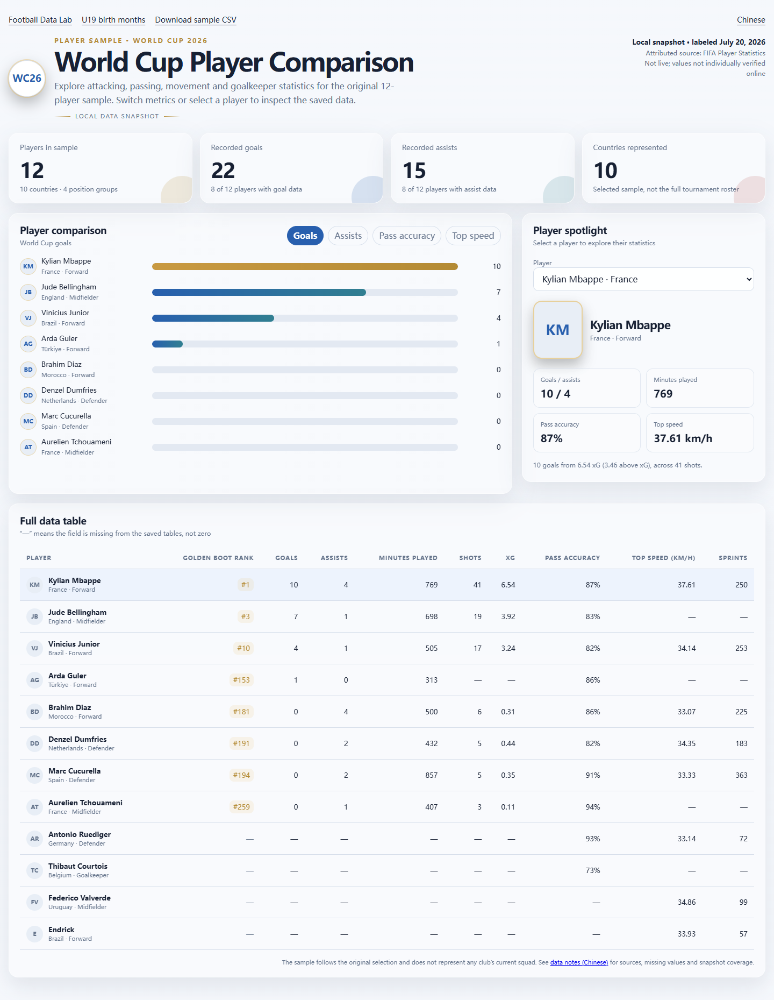

# Football Data Lab

[简体中文](README.md) | [English](README.en.md)

Two reproducible football analytics case studies: **U19 player birth-month distributions** and a **World Cup player comparison**.

The project includes two interactive dashboards with no third-party runtime dependencies, traceable local data snapshots, reproducible aggregation scripts, and CSV exports.

Source repository: [williamwenlma/football-data-lab](https://github.com/williamwenlma/football-data-lab).

## Case studies

### 01. U19 player birth-month distributions

This case study uses 182 records with dates of birth extracted from qualifying-phase squad tables in UEFA's *2025 U19 Final Tournament Press Kit*. It visualizes monthly distributions across seven countries, with country filtering, keyboard-accessible tooltips, horizontal charts on mobile, and support for reduced-motion preferences.

These are **qualifying-phase squad records**, not final tournament rosters. Romania is excluded because the relevant pages do not provide a comparable qualifying squad table with birth dates. The sample alone cannot establish birth-month distributions across the wider youth football population or support causal conclusions.


### 02. World Cup player comparison

This case study retains the original project's selection of 12 players. It joins locally saved FIFA statistical tables by player name to display goals, assists, passing accuracy, top speed, and individual player profiles.

The dashboard is available in [English](cases/world-cup/index.en.html) and [Chinese](cases/world-cup/index.html), with a language switch on each page. The English view translates player labels, countries, positions, metrics, table headings and data notes. It also provides an [English sample CSV](data/csv/world-cup-cohort.en.csv). Both views use the same underlying statistics.

The sample covers 10 countries and four position groups. **It does not represent any club's current squad.** The original project labels the player snapshot date as July 20, 2026. These are not live data, and the saved values have not been independently checked online field by field. Each category table covers only part of the player population. Missing values remain `null`, appear as `—` in the dashboard, and are not replaced with zero. Aggregates also display the number of players with available data.



## Run locally

Requires Node.js 20 or later. Neither the dashboards nor the Node.js scripts have third-party runtime dependencies, so `npm install` is not required.

```sh
npm start
```

Open <http://127.0.0.1:4173/> and choose a case study from the home page.

For the English World Cup dashboard, open <http://127.0.0.1:4173/cases/world-cup/index.en.html> after starting the server. Links to HTML files on GitHub display their source; use the local server to run the interactive page.

```sh
npm run build   # Rebuild dashboard data and CSV exports from raw data
npm run check   # Check that generated files are current, then run data tests
```

To use another port, run `node scripts/serve.mjs --port=4180`. To preview a GitHub Pages project subpath, run `node scripts/serve.mjs --base=football-data-lab` and open `http://127.0.0.1:4173/football-data-lab/`.

The preview server listens only on `127.0.0.1`.

## Data pipeline

```text
UEFA PDF -> optional Python extraction -> u19-players.csv -> monthly aggregation -> U19 chart
Local FIFA category JSON -> name joins and field mapping -> 12-player sample -> World Cup dashboard
                                                        -> CSV exports and source-file SHA-256 hashes
```

The dashboards read generated files in `data/derived`; statistical values are not maintained manually inside page code. The `data/csv` directory contains U19 monthly aggregates, the 12-player World Cup sample, and CSV exports of eight player tables and seven team tables. Team data are retained as reusable resources; this version does not include a team dashboard.

For sources, fields, sample coverage, and missing-value rules, see [DATA_SOURCES.md (Chinese)](DATA_SOURCES.md). CSV files use UTF-8. In Excel, import them through **From Text/CSV** and select UTF-8 if needed.

### Extract the U19 records again

The original PDF is not distributed with this repository. Obtain it from the [official UEFA source](https://editorial.uefa.com/resources/029a-1df9fcba9b73-1eef3cfac692-1000/2025_u19_tournament_final.pdf), then install the optional extraction dependency:

```sh
python -m pip install -r requirements-extract.txt
python scripts/extract-u19.py /path/to/2025_u19_tournament_final.pdf
npm run build
npm run check
```

Python is not needed for ordinary previews or builds. The extractor includes checks specific to this PDF's layout and sample; it is not a general-purpose PDF table parser.

## Project structure

```text
cases/u19/            U19 page, styles, and interactions
cases/world-cup/      World Cup page, styles, and interactions
data/raw/             Individual records, category snapshots, and cohort selection
data/derived/         Generated JSON, browser data, and source manifest
data/csv/             Generated CSV exports
scripts/              Extraction, data builds, and local preview server
tests/                Coverage, joins, missing-value handling, and CSV checks
docs/images/          Dashboard screenshots
.github/workflows/    Data and generated-file consistency checks
```

## Publishing and future work

The site uses relative paths and supports GitHub Pages project subpaths. The source is published on GitHub; follow the [publishing guide (Chinese)](docs/PUBLISHING.md) to configure static hosting.

This version does not include an online scraper, live update jobs, machine learning models, or match prediction. Potential improvements include collection scripts, field-level online verification, broader samples, and team analysis.

## License and attribution

Original code and project documentation are released under the [MIT License](LICENSE). Third-party statistical records are attributed in the [data documentation (Chinese)](DATA_SOURCES.md); the code license does not change their original rights or terms of use. This release does not distribute the UEFA source PDF, player photographs, club crests, or font packages and background images from the original project.

This is an independent personal analytics project with no official affiliation with UEFA, FIFA, or any club.
