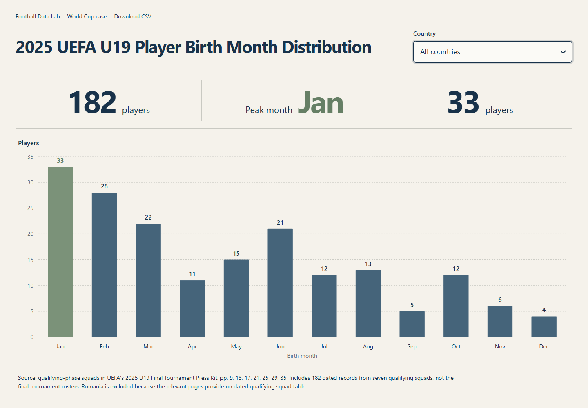
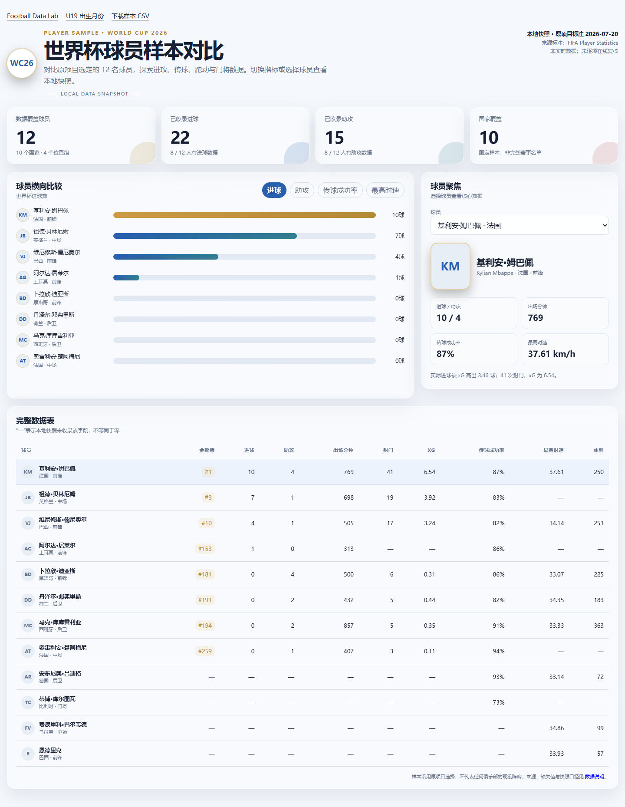

# Football Data Lab

[简体中文](README.md) | [English](README.en.md)

两个可复现的足球数据分析案例：**U19 球员出生月份分布**与**世界杯球员样本对比**。

项目包含两个无第三方运行依赖的交互看板、可追溯的数据快照、可复现的汇总脚本和 CSV 导出。

源码仓库：[williamwenlma/football-data-lab](https://github.com/williamwenlma/football-data-lab)。

## 分析案例

### 01. U19 球员出生月份分布

从 UEFA《2025 U19 Final Tournament Press Kit》的预选赛阵容表中提取 182 条含生日记录，观察七个国家的月份分布。支持国家筛选、键盘聚焦提示、移动端横向图和减少动画偏好。

这是**预选赛阶段的阵容记录**，并非决赛圈最终报名名单。罗马尼亚未提供同口径的含生日预选赛阵容表，因此排除。不能仅据此推断完整青训人群的出生月份分布或因果关系。



### 02. 世界杯球员样本对比

沿用原项目选择的 12 名球员，将本地保存的 FIFA 分类统计快照按球员姓名连接，展示进球、助攻、传球成功率、最高时速与球员资料。

样本覆盖 10 个国家、4 个位置组，**不代表任何俱乐部的现役阵容**。原项目标注球员快照日期为 2026-07-20；这不是实时数据，也未逐字段在线复核。各子表只收录部分球员，缺失值保留为 `null`，页面显示 `—`，不填成零。汇总同时显示有效样本数。



## 本地运行

需要 Node.js 20 或更新版本。页面和 Node.js 脚本都没有第三方运行依赖，无需执行 `npm install`。

```sh
npm start
```

打开 <http://127.0.0.1:4173/>，从首页进入两个案例。

```sh
npm run build   # 根据 raw 数据重建图表数据和 CSV
npm run check   # 检查生成文件是否同步，再运行数据测试
```

换端口：`node scripts/serve.mjs --port=4180`。模拟 GitHub Pages 项目路径：`node scripts/serve.mjs --base=football-data-lab`，然后打开 `http://127.0.0.1:4173/football-data-lab/`。

本地服务器只监听 `127.0.0.1`，用于预览。

## 数据流程

```text
UEFA 官方 PDF ── 可选 Python 提取 ── u19-players.csv ── 月份汇总 ── U19 图表
FIFA 本地分类 JSON ── 姓名连接与字段映射 ── 12 人样本 ── 世界杯看板
                                  └── CSV 导出与来源文件 SHA-256
```

图表读取 `data/derived` 下由脚本生成的文件，不再在页面内手写统计值。`data/csv` 包含 U19 月度汇总、世界杯 12 人样本，以及 8 张球员和 7 张球队分类表的 CSV。球队数据作为可复用资源保留，当前没有球队看板。

数据来源、字段、样本范围和缺失值规则见 [DATA_SOURCES.md](DATA_SOURCES.md)。CSV 使用 UTF-8，Excel 用户可通过“从文本/CSV”选择 UTF-8 导入。

### 重新提取 U19

原始 PDF 不随仓库分发。先从 [UEFA 官方来源](https://editorial.uefa.com/resources/029a-1df9fcba9b73-1eef3cfac692-1000/2025_u19_tournament_final.pdf) 获取文件，再安装可选提取依赖：

```sh
python -m pip install -r requirements-extract.txt
python scripts/extract-u19.py /path/to/2025_u19_tournament_final.pdf
npm run build
npm run check
```

普通预览和构建不需要 Python。当前提取器针对这份 PDF 的版式和样本设有检查，不是通用 PDF 表格解析器。

## 目录

```text
cases/u19/            U19 页面、样式和交互
cases/world-cup/      世界杯页面、样式和交互
data/raw/             逐条记录、分类快照和样本名单
data/derived/         生成的 JSON、浏览器数据和来源摘要
data/csv/             生成的 CSV 导出
scripts/              提取、构建和本地预览
tests/                样本口径、连接、缺失值与 CSV 检查
docs/images/          页面预览图
.github/workflows/    数据和构建同步检查
```

## 发布与后续改进

站点使用相对路径，可在 GitHub Pages 项目子路径下运行。源码已发布到 GitHub；可按 [发布说明](docs/PUBLISHING.md) 配置静态托管。

当前版本没有在线爬虫、实时更新任务、机器学习模型或比赛预测功能。后续可增加采集脚本、字段级线上复核、更多样本与球队分析。

## 许可与来源

原创代码及项目说明采用 [MIT License](LICENSE)。第三方统计记录的来源见 [数据说明](DATA_SOURCES.md)，不因代码许可而改变其原有权利或使用条件。发布版不包含 UEFA 原始 PDF、球员照片、俱乐部队徽、原项目的字体包或背景图。

本项目为个人数据分析作品，与 UEFA、FIFA 及任何俱乐部没有官方关联。
